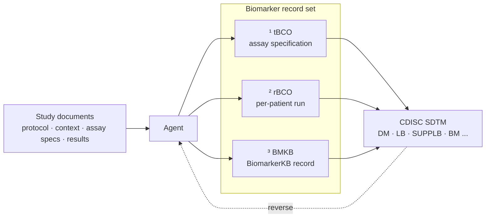

# biomarker-sdtm

An agent skill for transforming clinical data. It converts documents produced from a study into
**CDISC SDTM** outputs, and generates reproducible computational records that follow the
official **BioCompute Object** standard (IEEE 2791) alongside a **BiomarkerKB** record built
on a unified biomarker knowledge framework.

## 🔬 Generate submission-ready SDTM from your study documents

Provide the documents a biomarker study already produces: assay specification,
context of use, method validation report, patient results; and the skill returns
**CDISC SDTM** domains ready for downstream review:

> **DM · LB · SUPPLB · BM + further domains required**

`BM` is a **proposed** SDTM domain for **Biomarker** data. It supplies the biomarker context
for an assessment that already exists elsewhere, rather than duplicating patient-level results.

This skill also supports the reverse direction: given existing SDTM output, it reconstructs the
corresponding BioCompute Object and BiomarkerKB records, so legacy tabulations can be brought
into the modern pipeline with ease.



Each full run produces a **biomarker record set** that travel with the data:

- **¹ tBCO**: the _template_ BioCompute Object, the assay specification
- **² rBCO**: the _run_ BioCompute Object, one record per patient run
- **³ BMKB**: the BiomarkerKB record, what the biomarker means in controlled vocabulary

SDTM records _what the measured values were_. The record set records _how they were produced_
and _what they mean_, so the study remains reproducible and comparable long after the
spreadsheet is gone.

## Underlying standards and knowledge frameworks

**BioCompute Object (BCO).** A BCO is a machine-readable record of _how_ a computation was
performed: the scientific intent, the computational steps, the parameters, the software, and
the inputs and outputs. It is an IEEE standard (IEEE 2791), community-driven and peer-reviewed. For clinical
research it supplies a regulatory-grade audit trail, allowing an analysis to be re-executed and
verified years later rather than accepted on trust.

**BiomarkerKB.** BiomarkerKB is a knowledgebase that records what a biomarker _means_. It
captures the measured entity, the condition, and its role (diagnostic, prognostic, monitoring,
and others) in a controlled vocabulary, so that a finding from one study is directly
comparable with a finding from another. Full project description can be found in [_Patterns_ (2026)](https://doi.org/10.1016/j.patter.2026.101636).
For clinical research, it converts one-off biomarker measurements into
structured evidence that can be pooled, queried, and reused across trials.

Together the two close the gap that SDTM leaves open on its own: SDTM standardises the
_tabulation_, while BioCompute Objects and BiomarkerKB standardise the _provenance_ and the
_meaning_.

> Both projects are developed at George Washington University. BioCompute was developed with
> support from the U.S. Food and Drug Administration (-2026). BiomarkerKB is funded by the
> NIH Common Fund Data Ecosystem (CFDE).

**Resources**

- BioCompute Object Portal: <https://www.biocomputeobject.org/>
- IEEE 2791-2020 (BCO standard): <https://standards.ieee.org/standard/2791-2020.html>
- BiomarkerKB Portal: <https://biomarkerkb.org>
- BiomarkerKB data submission: <https://wiki.biomarkerkb.org/Data_Submission/Data_Upload>
- CDISC SDTM: <https://www.cdisc.org/standards/foundational/sdtm>
- BEST (Biomarkers, EndpointS, and other Tools) Resource, FDA-NIH Biomarker Working Group: <https://www.ncbi.nlm.nih.gov/books/NBK326791/>

## Quick Start

### Install as a Claude skill

1. **Download** the repository as a ZIP
   - On the repository page, choose `< > Code` → `Download ZIP`.

2. **Upload** the ZIP to Claude App
   - Go to `Settings` → `Skills` → `+ Add` → `Upload skill`.
   - Drag and drop the **ZIP** file to the drop zone → `Upload`.

3. **Invoke** it from any chat with the slash command:
   - Upload your clinical documents using `+` (Add files).
   - Invoke the skill with the slash command:

   ```
   /biomarker-sdtm
   ```

   We have included a set of simulated clinical documents in the skill package for demos. Try:

   ```
   /biomarker-sdtm help me draft a template BioCompute Object using the example troponin_I data available in the fixtures/ folder.
   ```

> [!TIP]
> Claude also loads `SKILL.md` automatically when a request matches it. Mention BioCompute, a
> tBCO or rBCO, BiomarkerKB, or SDTM and it will pick the skill up without the slash command.

### Install as a ChatGPT skill

1. Follow step 1 of the [Claude instructions](#install-as-a-claude-skill) to download the ZIP.

2. **Upload** the ZIP to ChatGPT App
   - Go to `Plugins` → Toggle to `Skills` → `Add` → `Upload from your computer`.
   - Drag and drop the **ZIP** file to the drop zone to upload.

## Layout

```
biomarker-sdtm/
├── SKILL.md              # the skill: frontmatter + workflow (start here)
├── README.md             # this file
├── CHANGELOG.md          # what changed and when
├── references/           # docs + IEEE 2791 schemas, loaded on demand
│   ├── README.md         # index, naming and versioning convention
│   ├── bmkb-model.md     # BiomarkerKB submission schema + accession lookup
│   ├── sdtmig-guide.md   # SDTMIG rules for DM, LB, SUPPLB, BM
│   ├── sdtmig-v3.4.pdf   # the full SDTMIG v3.4 specification
│   ├── bco-schema.md     # IEEE 2791 field spec
│   ├── best-definitions.md
│   ├── pitfalls.md
│   └── schemas/          # IEEE 2791 JSON Schemas
├── scripts/              # only what the agent needs at runtime
│   ├── finalize_draft.py        # strip //_ annotations, compute/verify the etag
│   ├── validate_bco.py          # IEEE 2791 structural validation
│   ├── validate_bmkb.py         # BMKB submission-schema validation
│   ├── biomarker_accessions.py  # entity type → accession resource
│   ├── censor_state.py          # analytic censoring logic
│   ├── record_set_to_sdtm.py     # record set → SDTM
│   └── sdtm_to_record_set.py     # SDTM → record set
├── assets/              # annotated templates the agent fills
├── examples/            # validated reference outputs + adjudication log
└── fixtures/            # simulated input documents for testing
```

## Compatibility checks (Developers)

Checks to confirm the helpers run correctly in your environment. No documents required.

```bash
cd scripts
python finalize_draft.py --self-test
python validate_bmkb.py  --self-test
python biomarker_accessions.py --self-test
python validate_bco.py ../examples/troponin_I/Troponin_I_tBCO.json
python record_set_to_sdtm.py --self-test
```

## Standard versions

| Resource                           | Version         | Reference                                                       |
| ---------------------------------- | --------------- | --------------------------------------------------------------- |
| BioCompute Object (BCO)            | IEEE 2791-2020  | https://standards.ieee.org/ieee/2791/7337/                      |
| SDTM (Study Data Tabulation Model) | v2.1 2024-06-07 | https://www.cdisc.org/standards/foundational/sdtm/sdtm-v2-1     |
| SDTMIG (SDTM Implementation Guide) | v3.4 2022-07-21 | https://www.cdisc.org/standards/foundational/sdtmig/sdtmig-v3-4 |

---

**This work is supported by [BiomarkerKB](https://biomarkerkb.org).**

---

## Disclaimer

> [!IMPORTANT]
> This skill is a **research and development tool**. It drafts structured records from study
> documents; it does not make decisions, and it does not submit anything to any regulator,
> sponsor or data provider. Everything it produces is a **draft requiring expert review**
> before it is used for anything.
>
> - **Not a regulatory submission.** The SDTM domains, BioCompute Objects and BiomarkerKB
>  records it produces are drafts. They are not validated for submission to any health
>  authority, and this skill does not provide regulatory advice. The sponsoring organisation
>  remains responsible for its own submissions and for verifying every value against the
>  source documents.
>- **Verify before relying on it.** Automated extraction from documents can be wrong, and a
>  `PLACEHOLDER` marks a value the documents did not supply; it is not a default. Treat every
>  generated field as a proposal to check, not a fact.
>- **Standards and schemas move.** The output formats follow the versions listed above.
>  Confirm them against the current published versions before submitting.
>- **No warranty or liability.** The skill is provided "as is", without warranty of any kind,
>  express or implied, including fitness for a particular purpose. The authors and their
>  institutions accept no liability for any loss or damage arising from its use.
